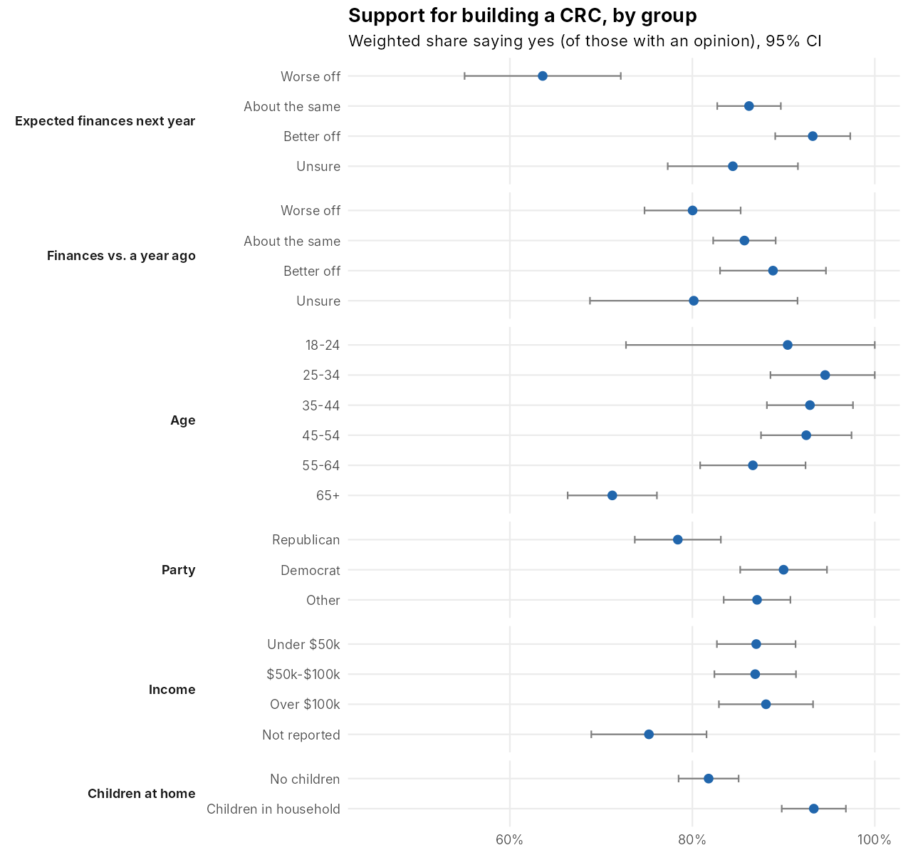
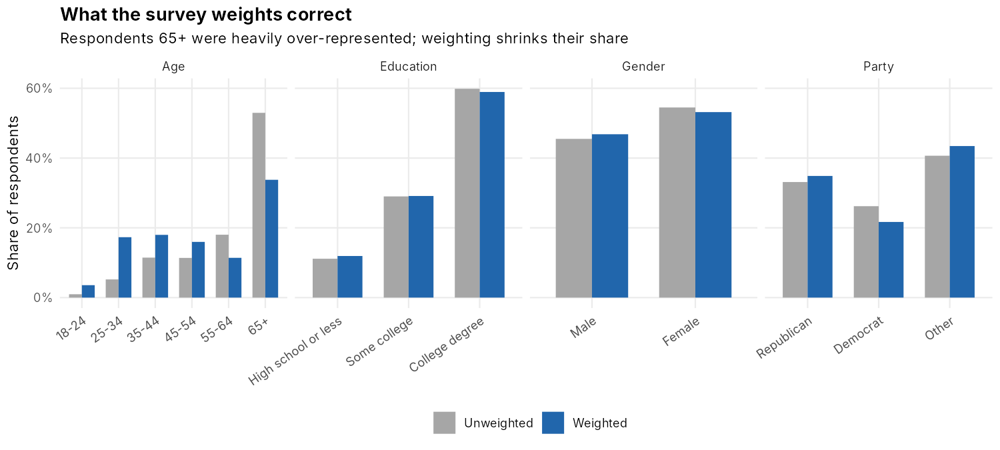
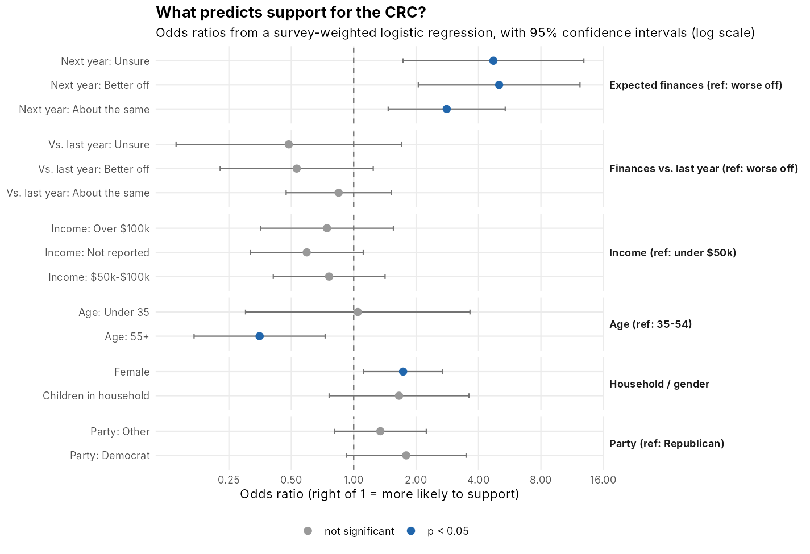
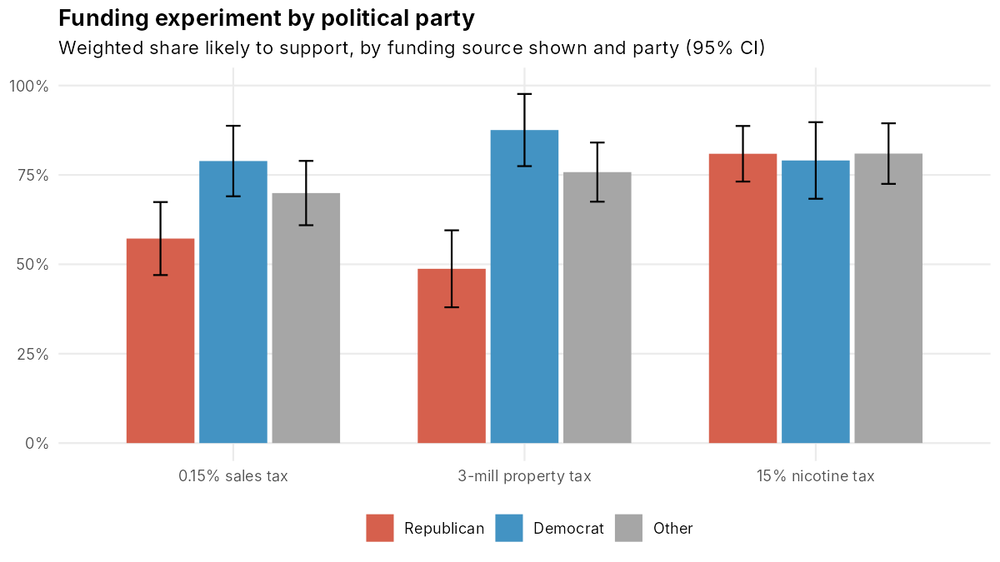
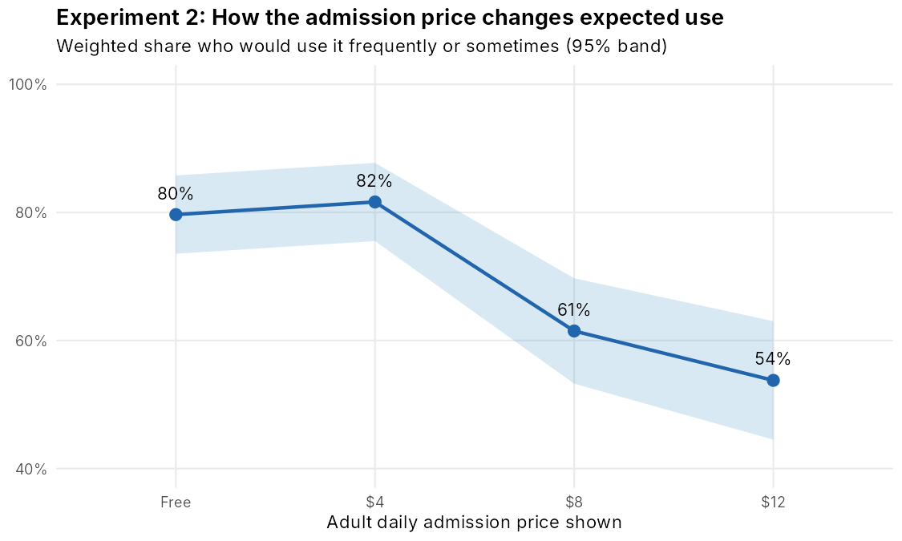

# What Drives Support for a Community Recreation Center? A Weighted Survey Analysis with Two Randomized Experiments

**Allan Ross** · B.S. Statistics, Colorado Mesa University · Categorical Data Analysis project, extended 2026

In February 2022 the City of Grand Junction, Colorado surveyed residents about building an indoor Community Recreation Center (CRC). The survey was run by the Colorado Mesa University Social Research Center with Franklin & Marshall College: 8,050 residents were invited, and 1,286 completed it (16%). This project asks three questions:

1. How much support is there once the sample is weighted to match the community?
2. Who supports the CRC, and why?
3. Two questions included **randomized experiments**: respondents were randomly shown one funding source and one admission price. What causal effect do those choices have?



## Key findings

| | Result |
|---|---|
| Overall support | **83%** (95% CI 80–85%) of residents with an opinion say Grand Junction should build a CRC (weighted) |
| Strongest predictor | People who expect to be *worse off* next year: 71% predicted support, vs. 92% for those expecting to be *better off* |
| Funding experiment | A **15% nicotine tax** raises support to **81%**, vs. 68% for a sales tax and 69% for a property tax (odds ratio 2.2, p < 0.001) |
| Who reacts to funding | Republicans: 49% support under a property tax, 81% under a nicotine tax. Democrats barely react (79–88%) |
| Price experiment | Expected regular use is the same at **free (80%) and $4 (82%)**, then falls to 61% at $8 and 54% at $12. Each extra $1 cuts the odds of more frequent use by 13% |

1. **Weighting matters.** Respondents 65+ make up 53% of the sample but 34% of the weighted population. The weights are uneven enough that the 1,286 responses carry the information of about **646** (design effect 2.0). Ignoring this makes results look more certain than they are.
   

2. **Financial *outlook* drives support, not current finances.** Once weighted, how people feel about the past year shows only a modest trend (weighted trend test p = 0.03; general Rao-Scott test p = 0.12), while expectations for next year are strongly related (p = 10⁻⁹). Income has no trend at all (p = 0.76); its overall association comes from income non-respondents being less supportive. In the full model, expected finances, age and gender are the only significant predictors.
   

3. **How the CRC is funded changes support, and the effect is partisan.** Because the funding source was randomly assigned, the 12-point gain for a nicotine tax is causal. Respondents' own stated preference (CC7) agrees: 49% prefer the nicotine tax.
   

4. **A $4 fee costs almost no users; $8 does.** This gives the city a pricing threshold, not just a demand curve.
   

## Methods

| Step | Script | What it does |
|---|---|---|
| 1 | `R/01_clean.R` | Labels every coded response from the codebook; builds simplified variables; non-response summary |
| 2 | `R/02_weights_and_eda.R` | Weight diagnostics (effective sample size, design effect), a from-scratch raking (IPF) demo, weighted headline results |
| 3 | `R/03_contingency_tables.R` | Unweighted Pearson vs. design-based Rao-Scott chi-square for 10 predictors; Fisher's exact test where cells are sparse; weighted trend tests for ordered predictors; Holm adjustment |
| 4 | `R/04_logistic_regression.R` | Reproduces the original `glm` model, refits it with `svyglm`, then an improved model with odds ratios, CIs, predicted probabilities, collinearity check and weighted AUC |
| 5 | `R/05_experiments.R` | Randomization balance checks; effects of funding source and price; survey-weighted proportional-odds models (`svyolr`); party interaction |
| 6 | `R/06_test_assumptions.R` | Rechecks the original chi-square tests: expected-count rule, Fisher exact test, linear-by-linear trend test, Holm adjustment |

**What changed from the first version** (the original scripts are in `legacy/`):

- **Correct standard errors.** `glm(..., weights = wt)` treats weights as counts of identical people. Refitting the same model with `svyglm` gives standard errors 8–78% larger; two effects that looked significant (better off than last year, $75k–$100k income) no longer are.
- **Corrected odds ratios.** For example, expecting to be better off next year multiplies the odds of support by 7.6 in the original model (not 14–15).
- **Income non-respondents kept.** 22% of respondents didn't report income. Instead of dropping them, they are a separate category, so the improved model uses 1,167 respondents instead of 893.
- **Data fixes.** CC9 "Don't know" answers are coded 8 in the data (the codebook says 5), so they had been silently set to missing. One empty trailing record is removed.
- **Test assumptions checked.** 6 of the 14 original chi-square tests had expected cell counts too small for the chi-square approximation. Fisher's exact test confirms all of their conclusions (script 6).
- **Experiments analyzed.** The randomized funding and price questions were only plotted before; they are now the headline causal results.

**Limitations.** The survey had a 16% response rate, and weighting can only correct for the characteristics it was built on. The price question was mostly not asked of residents who oppose any CRC (CC5 = 13), so that experiment describes likely users. Survey answers measure stated intentions, not actual behavior at the polls or the front desk. The raking demo recovers the official weights only partially (correlation 0.71) because the population targets and full raking variables weren't published with the data.

## Reproduce

```r
install.packages(c("dplyr", "tidyr", "ggplot2", "scales", "survey"))
```

```bash
Rscript run_all.R
```

**Data:** the survey file is property of the City of Grand Junction and the CMU Social Research Center and is not included in this repository. To reproduce, place `RecSurveyData.csv` in `data/`. The codebook is summarized in `R/01_clean.R`.

## Repository layout

```
├── run_all.R
├── R/                 # one script per step
├── data/              # RecSurveyData.csv goes here (not tracked)
└── output/
    ├── figures/       # 9 charts
    └── tables/        # results as CSV
```
